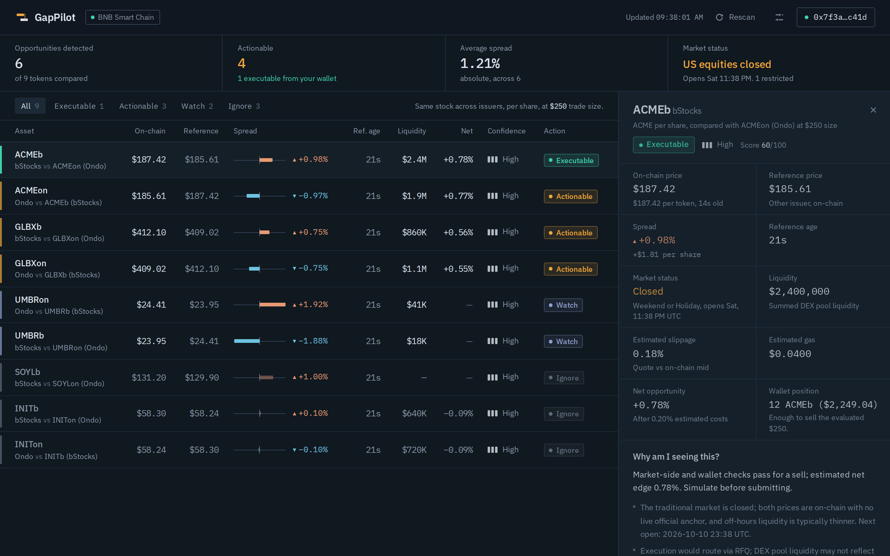
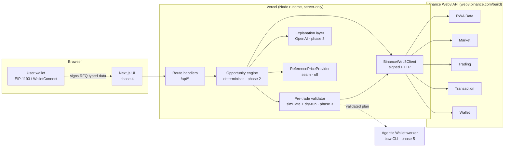
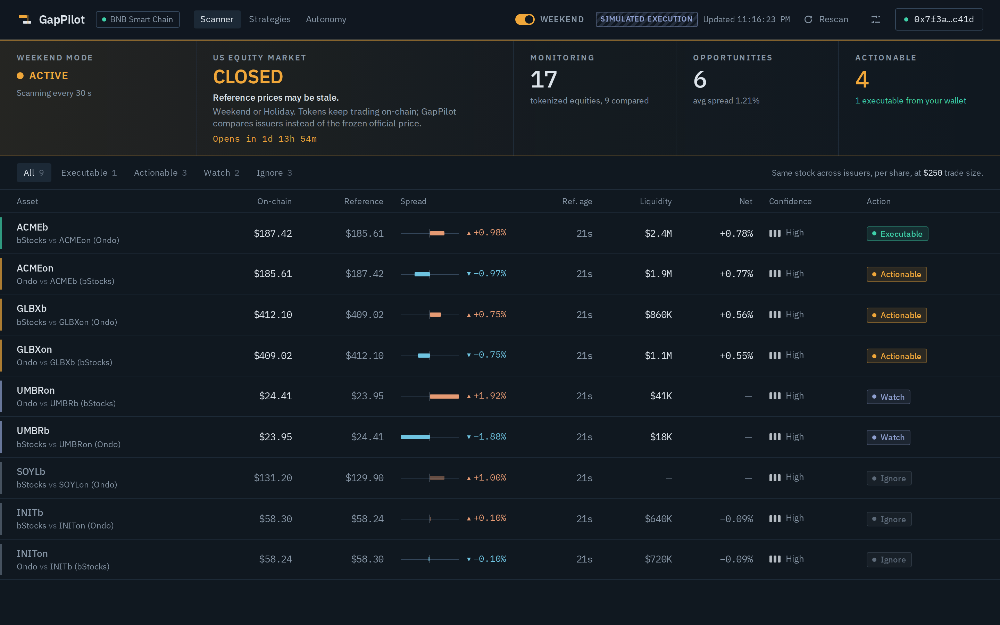
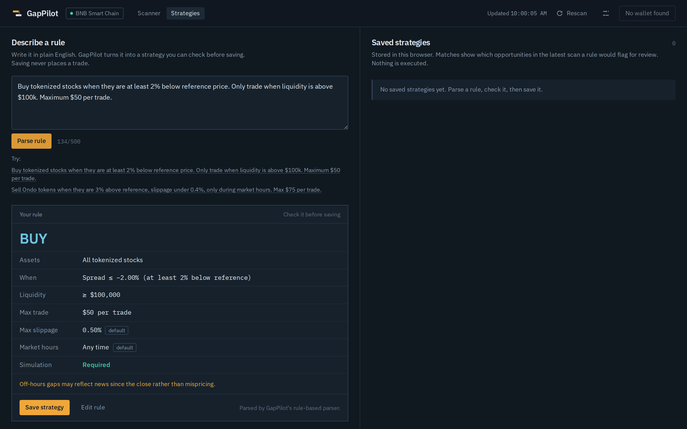
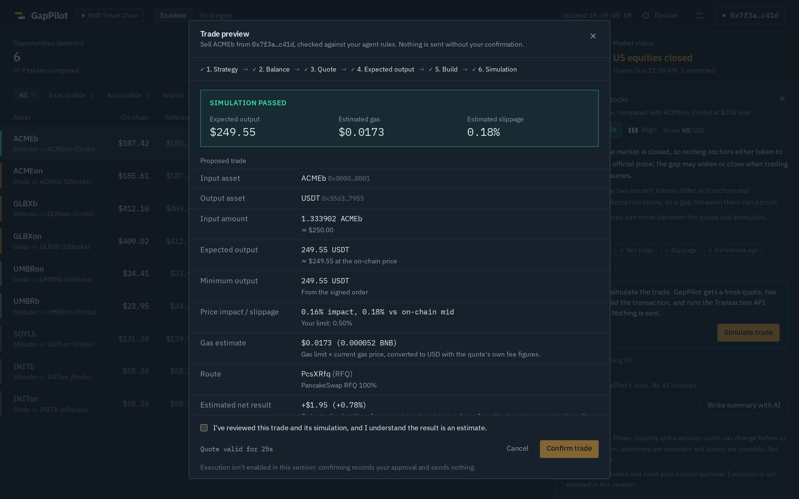
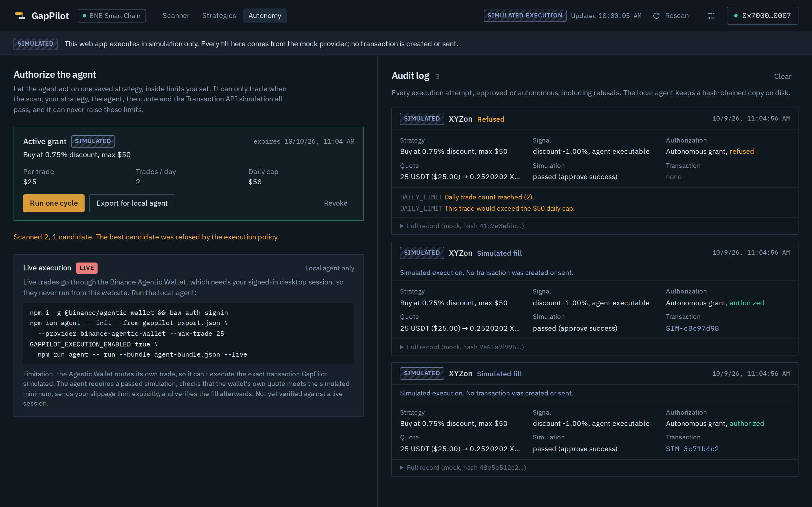

# GapPilot

Tokenized-stock opportunity detection on **BNB Smart Chain**, built on the
**Binance Web3 API** for *BNB Hack: Tokenized Stocks Edition*.

When US markets close, tokenized equities (bStocks, Ondo) keep trading on-chain.
GapPilot finds price divergences and decides whether each one is **actually
actionable** — after market status, price freshness, liquidity, real execution
cost and the connected wallet's holdings — instead of calling every difference
"arbitrage".

> **Status: phase 8 (execution providers + autonomy).** Deterministic engine, reasoning
> agent, strategy builder, Transaction API simulation, explicit approval, and an
> `ExecutionProvider` layer with a hash-chained audit log. **The web app only ever
> executes in simulation** (`MockExecutionProvider`). Live execution through the
> Binance Agentic Wallet runs only in the local agent worker, off by default, and
> has **not been verified against a live session**.
> See [Roadmap](#roadmap).



<sub>Screenshot rendered from the real engine on synthetic inputs with fictional tickers (ACME, GLBX, …), via the visual-QA harness. Not market data.</sub>

---

## The reference-price problem (read this first)

The RWA Data API returns `tokenPrice` and `referencePrice`. Per the spec,
`referencePrice` is **derived from the on-chain token price** — it is not an
official quote from the stock market. Comparing the two measures the
token-to-share conversion, not the weekend gap.

GapPilot therefore uses two signal types:

| Signal | What it compares | Data source | Status |
|---|---|---|---|
| `CROSS_ISSUER` (primary) | bStocks vs Ondo per-share price for the same ticker, each normalised by `tokenToShareRatio` | Binance Web3 API only | Phase 2 |
| `TOKEN_VS_REFERENCE` | Token per-share price vs an independent official close | External `ReferencePriceProvider` | Integration point; off |

Details and evidence: [`docs/binance-api-findings.md`](docs/binance-api-findings.md) (F1).

---

## Architecture



### Layers

**`src/lib/binance/` — Binance Web3 API client.**
- `signer.ts`: HMAC-SHA256 request signing (see [Authentication](#authentication)). Builds the wire URL and the signed path from one string so the `/build` prefix can't drift.
- `validation.ts`: Zod input schemas for every method, from the spec's parameter rules (address/hash formats, integer smallest-unit amounts, 100-address and 20-token batch limits, single-chain balances, slippage-or-autoSlippage, fee pairing). Bad input throws `kind: "validation"` and **sends nothing**.
- `http.ts`: signing, timeout (connect + body), envelope unwrapping (`code !== 0` is an error even on HTTP 200), response-shape validation, typed `BinanceApiError`, rate-limit headers, concurrency limit of 2, GET-only retries (429/5xx/network/timeout, honouring `Retry-After`), clock-skew warning, structured logs.
- `schemas.ts`: loose Zod response schemas. Unknown fields pass through; wrong *shapes* (object instead of array, number where the spec says string) fail with the exact path, e.g. `data.0.tokenPrice`.
- `errors.ts`: `BinanceApiError` with `kind` ∈ `validation | http | business | timeout | network | parse`.
- `modules/*`: `RwaApi`, `MarketApi`, `WalletApi`, `TradingApi` (read-only), `TransactionApi` (simulate + gas, no broadcast).
- `facade.ts` / `client.ts`: `BinanceWeb3Client`; `client.ts` is `server-only` and env-wired.
- `server/operations.ts`: the registry behind `/api/binance/*` (input schemas, BSC pinned, error → HTTP status mapping).
- `types/*`: request/response interfaces mirrored from Binance's official generated connector.

**`src/lib/rwa/rwa-service.ts` — RWA reads.** `discoverAssets` (both issuers on BSC, grouped by ticker, cross-issuer candidates), `getAssetInfo` (profile + market data + status + price, partial failures isolated), `priceRelationship` (token price vs `referencePrice`, implied ratio, deviation from `tokenToShareRatio`, per-share price, price age), `marketStatus` (normalised, with `available` and `isHardBlocked`).

**`src/lib/logging/` — structured logging.** JSON lines with three redaction layers: secret-looking keys, the registered API key/secret values, and signature / seed-phrase patterns. HTTP logs carry endpoint, attempt, latency, status, business code and rate limits — never headers, signatures or request bodies.

**`src/lib/engine/` — Opportunity Engine (deterministic, no LLM).** See [Opportunity Engine](#opportunity-engine).

**`src/lib/reference/` — reference-price seam.** `NoReferenceProvider` returns
`null`. Nothing fabricates a reference.

**`src/lib/config/env.ts` — validated environment.** Zod schema, readable errors, server-only.

## Opportunity Engine

Pure TypeScript in `src/lib/engine/`. No I/O, no randomness, no LLM: the clock is
an input, so the same input always yields the same `Opportunity`.

### Reference prices

| `reference.kind` | Meaning | Ceiling |
|---|---|---|
| `CROSS_ISSUER` | Same underlying's per-share price from the other issuer's token (bStocks ↔ Ondo). The scanner's signal. | EXECUTABLE |
| `EXTERNAL_OFFICIAL` | An official TradFi price from a `ReferencePriceProvider` (none configured yet). | EXECUTABLE |
| `BINANCE_DERIVED` | The API's `referencePrice`, derived from the token's own price. | **IGNORE** |

All prices are compared **per share** (`tokenPrice ÷ tokenToShareRatio`).

### Functions

| Function | Returns |
|---|---|
| `calculateSpread(onChain, ref)` | Signed USD/share difference (premium > 0); `null` on invalid input |
| `calculateSpreadPercent(onChain, ref)` | Signed % of the reference |
| `calculateReferenceAge(asOf, now)` | `{ ageMs, ageHours, clockSkew }` or `null` |
| `estimateSlippage(quote, tokenPrice)` | Quote output valued at the on-chain mid vs input (`QUOTE_VS_MID`), else `|priceImpact|` |
| `calculateNetOpportunity({...})` | `|spread| − (slippage + gas + tax)`; `null` when slippage is unknown; price improvement not credited |
| `calculateOpportunityScore({...})` | 0–100: 60 net edge, 20 liquidity, 20 confidence |
| `determineActionability(ctx)` | Action, confidence, gates, reasons |
| `evaluateOpportunity(input)` | The full typed `Opportunity` |

### Classification

The candidate starts at EXECUTABLE; each failing gate caps it; the lowest cap wins.

| Condition | Result |
|---|---|
| |spread| < 25 bps, derived reference, asset paused / corporate action, honeypot | IGNORE |
| No quote (costs unknown), liquidity < floor, size > 2% of liquidity, costs ≥ 50% of the spread, net edge < 50 bps | WATCH |
| No wallet; premium without enough token (**spot can't short**); discount without enough stablecoin; stale price / counterpart; expired quote (> 30 s); failed simulation; LOW confidence | ACTIONABLE |
| Everything passes | EXECUTABLE (+ "simulate before submitting") |

Confidence (0–1, multiplicative) drops for: market closed (×0.7 with an official
reference, which is also flagged `referencePotentiallyStale`; ×0.85 cross-issuer),
missing timestamps, unknown market status, unknown liquidity, stale data, no gas
estimate, price-impact-only slippage, stablecoin depeg. HIGH ≥ 0.75, MEDIUM ≥ 0.5.

Every `Opportunity` carries a fixed disclaimer; tests assert no reason ever
claims guaranteed or risk-free outcomes.

### Scanner

`OpportunityScanner.scan({ notional, wallet?, quoteTokenAddress })` discovers
cross-issuer pairs on BSC, batch-fetches prices, liquidity and balances, quotes
only legs that clear the noise band, and evaluates each token against its
counterpart. Without a wallet, nothing exceeds WATCH: RFQ quotes require a
wallet address. Partial upstream failures are listed in `errors`.

### Execution path (phase 5, not implemented)

The spec says equity/RWA tokens **always** settle via RFQ:
`/quote` → `/swap` (returns EIP-712 typed data) → user signs → `/order/submit` → poll `/order/{orderId}`.

`/simulate` runs EVM transactions, so it covers the ERC-20 approve but not the
vendor-settled fill. The planned pre-trade gate is: simulate the approve, run a
no-signature quote + `/swap` dry run, decode and check the typed data (receiver,
amounts, min-receive, deadline), and re-check balances. Whether Binance accepts
this as "simulated" is an open question.

No code path submits an order or broadcasts a transaction: `TradingApi` has no
submit method and `TransactionApi` has no broadcast method (tests assert both).

---

## Hosted test app (demo data)

`npm run build:demo` builds **one self-contained HTML file** (`dist-demo/gappilot-test-app.html`, ~0.9 MB) that
runs the real dashboard and GapPilot's real library code entirely in the browser:

- `src/demo/install.ts` routes `/api/*` to `src/demo/api.ts`, whose handlers call the same functions as the Next.js
  routes (scanner, attestation, agent, strategy compiler, trade planner, plan tokens, approval,
  `executeWithAuthorization` + `MockExecutionProvider`, grants, `runAutonomousCycle`).
- `src/demo/backend.ts` is a **simulated Binance Web3 API** (same paths, envelope and shapes): 17 fictional
  tokenized equities (6 cross-issuer pairs + 5 single listings), small price jitter per scan, a switchable US market,
  a demo wallet (1,000 USDT + 12 ACMEb) whose balances move after simulated fills.
- `node:crypto` and `Buffer` are replaced by browser shims (`src/demo/shims/`): synchronous SHA-256/HMAC tested
  byte-for-byte against Node, so signing, attestations, plan tokens and audit hashes behave exactly as on the server.
- A collapsed **DEMO DATA** control lets visitors switch the simulated market (Weekend Mode ACTIVE ↔ STANDBY), see the
  demo wallet, and reset. The build refuses to include any server-only or live-execution code.

Nothing in `src/demo/` is imported by the Next.js app. Tests: `tests/demo-shims.test.ts`, `tests/demo-api.test.ts`;
end-to-end: `python3 tests/visual/demo-e2e.py $PWD/dist-demo/gappilot-test-app.html /tmp/shots`.

## Weekend Mode

A header switch (on by default) that turns the top of the Scanner into the off-hours story:

```
WEEKEND MODE      US EQUITY MARKET                      MONITORING   OPPORTUNITIES   ACTIONABLE
● ACTIVE          CLOSED                                17           6               4
                  Reference prices may be stale.        tokenized    avg spread      1 executable
                  Opens in 1d 13h 56m                   equities     1.21%           from your wallet
```

Every figure comes from the latest scan (`deriveWeekendState`, unit-tested); nothing is hardcoded.

- **ACTIVE** only when Binance's RWA market status says the US market is closed; **STANDBY** (hollow dot, green OPEN)
  when it's open; **UNKNOWN** before the first scan or when status isn't reported.
- **Monitoring** = every bStocks/Ondo token discovered on BSC (`ScanResult.assetsDiscovered`), with how many were
  compared across issuers. **Opportunities** = non-IGNORE; **Actionable** = ACTIONABLE + EXECUTABLE.
- The countdown uses the API's `nextOpenTime`. While ACTIVE, the scan refreshes every 30 s unless you set your own interval.
- Off: the regular summary strip returns. The choice is remembered in the browser.



## Dashboard

`src/app/page.tsx` → `src/components/dashboard/`. A client app over two public, read-only routes.

| Area | What it shows |
|---|---|
| Header | Logo, BNB Smart Chain indicator (amber if the wallet is on another network), last update, rescan, settings, wallet |
| Summary | Opportunities detected (non-IGNORE), actionable (+ executable from your wallet), average absolute spread, US market status |
| Table | Asset, on-chain, reference (both per share), spread with a diverging gap bar, reference age, liquidity, net, confidence, action. Filter by action. Cards below `md`. |
| Detail panel | All engine metrics, wallet position, "Why am I seeing this?" (engine reasons + check chips), the Agent (decision, recommended action, summary, risks, your rule checks, reasoning), disclaimer. Docked right on desktop, full-screen sheet on mobile, `Esc` closes. |
| Settings | Trade size, pairs, auto-refresh, and the agent's rules (max size, min net edge, max slippage, max reference age, min confidence, off-hours trades). |

States: skeleton loading, empty (no cross-listed ticker / empty filter), API errors mapped to a cause and a fix
(config, Binance 401/403/429, timeout, malformed data, offline), stale-data banner when a rescan fails, partial-failure disclosure.

**Wallet.** Plain EIP-1193 (`window.ethereum`): reads the account and chain only. No signing, no WalletConnect.
The address is sent to `/api/opportunities` to fetch balances and RFQ quotes.

**Design.** Graphite-blue terminal palette; each status colour has one meaning (mint executable, amber
actionable, periwinkle watch, ash ignore); premium/discount are copper/sky rather than red/green because a
spread's sign isn't good or bad. IBM Plex Sans for UI, IBM Plex Mono with tabular figures for numbers,
both self-hosted via npm (no build-time font download). Desktop is an app shell: table and panel scroll
independently. Respects reduced motion; visible focus rings; keyboard-selectable rows.

## Reasoning agent

`src/lib/agent/`. Reads ONE engine `Opportunity` plus the user's rules and returns:

```ts
{ decision, confidence, summary, reasons[], risks[], recommendedAction }   // + audit fields
```

`decision` uses the engine's vocabulary; `recommendedAction` is `WAIT`, `SIMULATE` or `NO_ACTION`.
Authority order: **engine → deterministic policy → optional LLM**. Each layer can keep or tighten, never loosen.

| Engine says | Agent decides |
|---|---|
| IGNORE | IGNORE · NO_ACTION |
| WATCH | WATCH · WAIT |
| ACTIONABLE, wallet structurally can't (premium without tokens; discount without stablecoin) or simulation failed | WATCH · NO_ACTION (waiting won't change it) |
| ACTIONABLE, a user rule fails | WATCH · WAIT |
| ACTIONABLE, temporary (stale data, expired quote, no wallet, low confidence) | ACTIONABLE · WAIT |
| EXECUTABLE, a user rule fails | WATCH · WAIT |
| EXECUTABLE, main risk HIGH | ACTIONABLE · WAIT (confidence capped at MEDIUM) |
| EXECUTABLE, all rules pass, no HIGH risk | EXECUTABLE · SIMULATE — never "execute" |

**User rules** (`UserRulesSchema`, defaults in brackets): max trade size [$1,000], min net edge [0.5%],
max slippage [0.5%], max reference age [24 h], min confidence [MEDIUM], allow off-hours [yes].
Unknown data fails the related rule. Rules apply on top of the engine, so they can only make it stricter.

**Risks** are a fixed catalog with severities (derived reference, corporate action, token safety, stale
reference, data freshness, execution cost, liquidity, off-hours, token tax, issuer structure, price
movement). The main risk is the highest severity; ties go to the more fundamental one.

**Summary** is three deterministic sentences: the gap, the main risk, and whether this wallet can act.
For the specification example (TSLA $462 vs $450 reference, 41 h old, market closed, $1.2M liquidity,
0.21% slippage, no TSLA held) the agent returns `WATCH` / `NO_ACTION` and exactly the expected summary;
`tests/agent.test.ts` asserts it word for word.

**Optional LLM narrator** (`agent/narrator.ts`, server-only). OpenAI Responses API with a strict JSON
schema: `{ summary, decision, recommendedAction, confidence, mainRiskCode }`. It receives the engine
fact sheet plus the policy output, and:

- any decision/action/confidence **less** conservative than the policy is clamped and recorded in `guardrails.clamped`;
- the summary is discarded (one retry, then the deterministic summary is used) if it contains a number
  not present in the facts, promissory language, hex/calldata, or trade instructions ("sell now");
- an unknown `mainRiskCode` is replaced by the policy's.

The agent module imports no Binance client, wallet code or transaction builder; a test reads its source
files to enforce that. The browser runs the same deterministic function (`agent/deterministic.ts`) for an
instant result; the LLM client and prompt never ship to the browser.

The engine output reaching `/api/agent` must carry the server's HMAC attestation (from
`/api/opportunities`), so browser-edited numbers are rejected before the agent or the LLM sees them.

## Natural-language strategy builder

`src/lib/strategy/` + **Strategies** view. Type a rule; GapPilot shows the parsed strategy; you save it.
Saving stores it in your browser and executes nothing.

```
"Buy tokenized stocks when they are at least 2% below reference price.
 Only trade when liquidity is above $100k. Maximum $50 per trade."
        │
        ▼  parser (LLM if configured, else rule-based) → Extraction (untrusted)
        ▼  deterministic compiler → Strategy (validated) or a list of reasons it can't be saved
{ action: "BUY", assetScope: { type: "ALL" }, spreadThresholdPercent: -2, minimumLiquidityUsd: 100000,
  maximumTradeUsd: 50, maximumSlippagePercent: 0.5 (default), marketStatus: "ANY" (default),
  requireSimulation: true }
```

**The LLM only parses.** It returns raw fields with `null` for anything unstated, verbatim quotes, and
flags (strict JSON schema, OpenAI Responses API). The user's text is passed as delimited data. It has no
route to save, validate or act.

**The compiler decides** (`strategy/compile.ts`), never trusting the parser:

| Check | Rejects |
|---|---|
| Raw-text safety scan (independent of the parser) | leverage, margin, `5x`, perpetuals, futures, options, shorting, borrowing; stake/bridge/lend/LP/transfer; addresses or hex; unlimited approvals; gas/calldata/keys; "skip simulation"; auto-execution |
| Trade size | missing; % of balance; "all my USDT"; "as much as possible"; ranges; "around $50 per trade"; above the $10,000 cap |
| Asset scope | missing; tickers not literally in the text; issuers other than bStocks/Ondo |
| Thresholds | \|spread\| < 0.25% or > 25%; BUY at a premium / SELL at a discount; liquidity below the engine's $25k floor; slippage > 2% or ≥ the spread |
| **Grounding** | any numeric value (trade size, spread, liquidity, slippage) that doesn't appear in the user's text, so a hallucinated "$500" can't slip in |
| Schema (`StrategySchema`, strict) | unknown keys; `requireSimulation` is `z.literal(true)`; no fields exist for addresses, calldata, gas, leverage or auto-execution |

Unstated optional fields get documented defaults that the confirmation card tags as **default**: liquidity
≥ $25,000, slippage min(0.5%, ½ threshold), any market hours. Without `OPENAI_API_KEY`, the rule-based parser
fills the same Extraction, so the feature works offline and every check still applies.

**Saved strategies** live in `localStorage` and are re-validated against the schema on every load.
Each shows a read-only preview of which opportunities in the latest scan it would flag (`matchStrategy`).



## Transaction simulation and approval

`src/lib/trade/` + **Simulate trade** in the Agent panel (shown only when the agent recommends SIMULATE).

```
Opportunity ─► strategy/rules gate ─► balance (Wallet API) ─► quote (Trading API) ─► expected output
  ─► Binance-built transactions (/approve-transaction, /swap) ─► /pre-transaction/simulate ─► preview
  ─► explicit approval (tick + Confirm, before the 30 s quote expires) ─► execution entry point: refuses
```

**Gates before anything is built** (`BLOCKED`): agent decision must be EXECUTABLE under your rules; a
selected saved strategy must match (its max trade and slippage cap the trade); wallet balance must cover the
input; the fresh quote's slippage must be within your limit and its net edge above your minimum; honeypot
tokens are refused.

**Transactions are built by Binance, only checked by GapPilot**: no calldata is ever written by GapPilot.

| Step | Verification |
|---|---|
| ERC-20 approval | Decoded: must be `approve()`, **exact trade amount (never unlimited)**, spender = quote's `approveTarget`. **Simulated**; simulated allowance must equal the amount for that spender. |
| SWAP transaction | Sender = your wallet, `value` = 0, `minReceiveAmount` within your slippage. **Simulated**; simulated balance changes must spend exactly the input and receive at least the minimum. |
| RFQ order (equities) | Off-chain EIP-712 order, which the Transaction API can't simulate. Typed data is decoded and checked: chain 56, receiver/owner = your wallet, sell amount = quote, buy amount ≥ slippage floor, deadline within the hour. |

| Status | Meaning | Confirm allowed? |
|---|---|---|
| `PASSED` | Every simulatable step simulated and passed; every check holds | Yes, with a tick box, before expiry |
| `FAILED` | A simulation or check failed; the reason is shown | No |
| `BLOCKED` | A gate stopped it before building | No |
| `APPROVAL_REQUIRED` | SWAP route needs an approval mined before the swap can be simulated | No |
| `UNVERIFIABLE` | Nothing simulatable (RFQ with existing allowance), or typed data unreadable | No |

The preview shows input/output asset, input amount, expected and minimum output (with its source),
price impact and estimated slippage vs your limit, gas (gas limit × current gas price in BNB; USD
converted with the quote's own `tradeFee ÷ estimateGasFee`), route (vendor, mode, hops), and estimated
net result valued at the reference price, always labelled as an estimate.

**Approval** (`trade/approval.ts`): a server-signed plan token (HMAC; binds the preview hash, wallet,
quote, amounts, expiry, and the rules and strategy it was simulated under) is issued **only for PASSED
previews**. `/api/trade/approve` requires that token, the same wallet, `confirm: true`, an unexpired quote,
and the exact simulated preview (hash-checked). The approved trade then goes through the execution layer
below: `authorizeExecution` → provider → audit record. In the web app the provider is always
`MockExecutionProvider`, so the result is a **simulated** fill and nothing is sent.

**Known limitation.** Every tokenized-stock trade is RFQ. After the first approval, `approveTarget` is null,
so there is no on-chain transaction to simulate and repeat trades show `UNVERIFIABLE`. GapPilot won't
present typed-data checks as a simulation. See `docs/binance-api-findings.md` (D12).



## Execution providers, autonomy and audit

`src/lib/execution/`. Every execution, whether you approved it or the agent ran it autonomously,
takes one path:

```
PASSED preview ─► ExecutionRequest (server-built) ─► provider.preflight ─► authorizeExecution (deterministic)
   ─► provider.execute (only if authorized; providers re-check the proof) ─► hash-chained AuditRecord (always)
```

### Providers

| | `MockExecutionProvider` | `BinanceAgenticWalletProvider` |
|---|---|---|
| Mode | **SIMULATED** | **LIVE** |
| What happens | Deterministic fill at the quoted output; nothing leaves GapPilot | Real order via the `baw` CLI (`@binance/agentic-wallet`), `execFile` with no shell, `--json` |
| Tx hash | `SIMULATED-<id>` (never `0x…`) | Real `0x…` from `market-order list` |
| Where | Web app (always) and local worker | **Local agent worker only**; the web app constructs it in serverless mode, so it always refuses |
| Enabled by | Default | Grant provider `binance-agentic-wallet` + `GAPPILOT_EXECUTION_ENABLED=true` + `--live` + signed-in `baw` |
| Verified | Unit + end-to-end tests | Against a fake CLI only; **not against a live session** |

**Agentic Wallet findings** (from the CLI's README, help text and source, v1.10.0, 2026-09-09): commands are
documented; option lists and `--json` shapes are not (read from the CLI's own code). `market-order swap`
takes `fromToken`, `toToken`, `fromTokenQty`, `--slippage` (`auto` or 0–100), `--mev`, `--gasLevel` and returns only
`{ orderId }`; there is **no quote ID or minimum-output parameter**, and the JSON quote omits its quote ID. The
session lives in the OS keychain after a QR sign-in, and daily limits are set in the Binance App (`left-quota`).

Because `baw` builds and routes its own trade, **it cannot execute the exact transaction GapPilot simulated**.
The adapter compensates, and says so in the UI:

1. A PASSED Transaction API simulation is required (policy).
2. Preflight before every execution: pinned CLI version (`1.10.x`), `CONNECTED`, BSC address equals the simulated
   wallet, `tx-lock` `UNLOCKED`, `left-quota` ≥ trade size.
3. `baw`'s own quote must be at or above the simulated minimum output, with its slippage ≤ your limit, or no swap is sent.
4. The swap is sent with `--slippage <your limit>`, never `auto`.
5. After settlement, actual output is compared with the minimum: shortfalls are recorded as `FILLED_BELOW_MINIMUM`;
   unconfirmed orders as `PENDING`.

### Hard constraints (`authorizeExecution`)

| Constraint | Enforcement |
|---|---|
| Can't increase max trade size | Limit = min(user rules, strategy, grant); grants can't exceed the strategy (`createGrant`); request USD > limit → refused |
| Can't bypass simulation | Preview must be PASSED with ≥1 simulated tx, unexpired, and hash-identical to the request; providers re-check the proof (`assertProof`) |
| Can't bypass slippage | Request slippage and estimated slippage ≤ min(rules, strategy); minimum output must be > 0; executed at exactly that limit |
| No unsupported assets | Issuer ∈ {bStocks, Ondo}; chain 56; the pair must be the scanned token ↔ configured stablecoin; strategy scope respected |
| No leverage / perps | Requests are typed `SPOT_SWAP` only; anything else refused; strategies can't express leverage |
| Can't override wallet safety | Same wallet as simulated (and as the provider's wallet); balance verified; exact-amount approval only; all tx and RFQ checks passed; provider ready; wallet quota sufficient |
| Autonomous only | Agent decision EXECUTABLE; strategy still matches; grant valid, unexpired, bound to the strategy hash; daily trade count and USD cap per grant; no duplicate quote |

Every one of these has a test, and each was mutation-tested (removing the check makes a test fail).

### Autonomy

- **Web demo (Autonomy view)**: choose a saved strategy, set per-trade (≤ strategy), trades/day, daily cap and duration,
  tick consent → server-signed grant (always `mock`). **Run one cycle**: scan → strategy → agent → quote → build → simulate →
  authorize → simulated fill. At most one execution per cycle.
- **Local agent worker**:

```bash
npm run agent -- init --from gappilot-export.json --provider binance-agentic-wallet --max-trade 25 --trades-per-day 3 --daily 75 --hours 24
npm run agent -- run --bundle agent-bundle.json --wallet 0xYourWallet          # SIMULATED
GAPPILOT_EXECUTION_ENABLED=true npm run agent -- run --bundle agent-bundle.json --live [--interval 60]   # LIVE
npm run agent -- verify-audit
```

  The export comes from the Autonomy view. The worker refuses bundles whose strategy doesn't match the grant hash,
  prints a SIMULATED or LIVE banner, and writes `audit/agent-audit.jsonl` (verified on open; refuses to continue if the chain is broken).

### Audit record

`timestamp, mode (SIMULATED|LIVE), provider, asset, strategy (name + hash), signal (direction, spread, reference,
engine action, agent decision), quote (id, vendor, mode, input + inputUsd, expected, minimum, slippage limit),
simulation (status, per-tx results, failure reason), authorization (USER_APPROVED|AUTONOMOUS_GRANT|NONE, approval/grant id,
verdict, violations), execution (status, orderId, txHash, actual output), result, prevHash, hash`.
Refusals are recorded too. The web demo keeps records in memory per server instance and returns them to the browser;
the local worker's JSONL file is the durable, verifiable log.

**Caveat:** daily caps are per grant. Across grants, the ceiling for live trading is the daily limit set in the Binance
App, which preflight enforces.



### Public routes

| Route | Purpose | Protection |
|---|---|---|
| `GET /api/opportunities?notional&wallet&maxPairs` | Scan for the dashboard | Zod-validated; 30/min per IP; 15 s cache + in-flight de-dup |
| `POST /api/agent` `{ opportunity, attestation, rules?, narrate? }` | Reasoning agent | Attestation required; rules validated; 120/min (deterministic) and 10/min (narrated) per IP; cached |
| `POST /api/strategy/parse` `{ text }` | Parse + compile a rule (saves nothing) | ≤ 500 chars; 15/min per IP |
| `POST /api/trade/simulate` `{ opportunity, attestation, wallet, rules?, strategy? }` | Quote, build, simulate | Attestation required; scan ≤ 5 min old; 10/min per IP; never signs or sends |
| `POST /api/trade/approve` `{ planToken, wallet, confirm: true, preview, opportunity, attestation }` | Explicit approval → execution (SIMULATED in the web app) → audit record | Plan token binds preview hash, wallet, rules and strategy; attestation verified |
| `POST /api/autonomy/grant` `{ strategy, strategyName, maxTradeUsd, maxTradesPerDay, maxDailyUsd, durationHours, consent: true }` | Signed autonomous grant (mock) | Per-trade ≤ strategy; ≤ 7 days |
| `POST /api/autonomy/run` `{ grantToken, strategy, rules?, wallet }` | One autonomous cycle, SIMULATED | Grant signature verified; 6/min per IP |

`/api/binance/*` remains the token-protected integration surface.

## Binance Web3 API endpoints used

All paths are under `https://web3.binance.com/build` and every call is signed.
Source of truth: Binance's official generated connector `@binance-web3/wallet@13.0.1`.

| Purpose | Method + path | Module | Status |
|---|---|---|---|
| Issuers | `GET /api/v1/dex/market/rwa/platforms` | RWA | ✅ |
| Discovery | `GET /api/v1/dex/market/rwa/tokens` | RWA | ✅ |
| Cross-issuer pairing | `GET /api/v1/dex/market/rwa/search` | RWA | ✅ |
| On-chain price + age | `GET /api/v1/dex/market/rwa/price` | RWA | ✅ |
| Market status | `GET /api/v1/dex/market/rwa/underlying-market` | RWA | ✅ |
| Share ratio, attestations | `GET /api/v1/dex/market/rwa/underlying-profile` | RWA | ✅ |
| Decimals / metadata | `POST /api/v1/dex/market/token/basic-info` (query params) | Market | ✅ |
| Liquidity | `GET /api/v1/dex/market/token/top-liquidity` | Market | ✅ |
| Token price | `POST /api/v1/dex/market/price` | Market | ⚠ body undocumented — not wired |
| Trading info | `POST /api/v1/dex/market/price-info` | Market | ⚠ body undocumented — not wired |
| Quote | `GET /api/v1/dex/aggregator/quote` | Trading | ✅ |
| Build swap / RFQ | `GET /api/v1/dex/aggregator/swap` | Trading | ✅ |
| Approve calldata | `GET /api/v1/dex/aggregator/approve-transaction` | Trading | ✅ |
| Submit RFQ | `POST /api/v1/dex/aggregator/order/submit` | Trading | ⛔ not implemented (execution); `quoteId` ambiguity |
| RFQ status | `GET /api/v1/dex/aggregator/order/{orderId}` | Trading | ✅ |
| Swap tx status | `GET /api/v1/dex/aggregator/history` | Trading | ✅ |
| Simulate | `POST /api/v1/dex/pre-transaction/simulate` | Transaction | ✅ |
| Gas price / limit | `GET …/gas-price`, `POST …/gas-limit` | Transaction | ✅ |
| Balances | `GET /api/v1/dex/balance/all-token-balances-by-address`, `POST …/token-balances-by-address` | Wallet | ✅ |
| Tx detail | `GET /api/v1/dex/post-transaction/transaction-detail-by-txhash` | Wallet | ✅ |

---

## Authentication

Implemented in `src/lib/binance/signer.ts` + `http.ts`, matching Binance's
official connector (`@binance-web3/common@1.1.2`):

```
X-OC-TIMESTAMP = new Date().toISOString()            e.g. 2026-10-08T12:00:00.000Z
prehash        = timestamp + METHOD + requestPath + body
requestPath    = "/build" + path + "?" + URLSearchParams   (exactly as sent)
X-OC-SIGN      = base64( HMAC-SHA256(apiSecret, prehash) )
headers        = X-OC-APIKEY, X-OC-TIMESTAMP, X-OC-SIGN, X-OC-RECV-WINDOW, X-OC-NONCE (UUID)
```

Tests check the signature against vectors computed independently in Python.
The official docs page could not be rendered from the build environment; the
scheme is taken from the official SDK source and matches two other teams'
independent implementations.

## Getting started

Requirements: Node.js **≥ 22.12**, a Binance Web3 API key from
<https://web3.binance.com/en/dev-portal>.

```bash
npm install                     # .npmrc sets legacy-peer-deps (npm 10 bug, see findings doc)
cp .env.example .env.local      # fill in BINANCE_WEB3_API_KEY / _SECRET
npm run typecheck
npm test                        # 314 offline tests, no network
npm run smoke                   # first REAL signed calls, read-only
npm run scan                    # live opportunity table (add --wallet 0x... --notional 250)
npm run dev                     # dashboard at http://localhost:3000
```

## Testing each integration

Offline (fake fetch, no network, no key needed):

```bash
npm test                                   # everything
npx vitest run tests/signer.test.ts        # authentication vectors
npx vitest run tests/http.test.ts          # auth headers, success, failures, malformed, timeouts, log hygiene
npx vitest run tests/modules.test.ts       # per-API input validation
npx vitest run tests/rwa-service.test.ts   # discovery, price relationship, market status
npx vitest run tests/operations.test.ts    # /api/binance/* status mapping, no leaks
npx vitest run tests/logger.test.ts        # redaction
npx vitest run tests/engine.calculations.test.ts   # spread, age, slippage, net, score
npx vitest run tests/engine.scenarios.test.ts      # every classification rule
npx vitest run tests/engine.scanner.test.ts        # adapters + end-to-end scan (fake API)
npx vitest run tests/agent.test.ts         # spec example, decision mapping, rule limits, LLM clamping, output safety
npx vitest run tests/strategy.test.ts      # spec example, every rejection category, grounding, false positives, LLM contract
npx vitest run tests/trade.test.ts         # PASSED/FAILED/BLOCKED/APPROVAL_REQUIRED/UNVERIFIABLE, approval, no submit/broadcast
npx vitest run tests/execution.test.ts     # every hard constraint, both providers (fake baw CLI), audit chain, autonomous cycles
npx vitest run tests/assessment.test.ts    # attestation, fact sheet, number validator, OpenAI client
npx vitest run tests/client.test.ts        # rate limiter, summary, formatting, settings
npx vitest run tests/weekend.test.ts       # Weekend Mode state and countdown
```

Visual QA (screenshots of the production build; API intercepted in the browser with engine output on
synthetic inputs; needs Python Playwright + Chromium):

```bash
npm run build && npm start &
npx tsx tests/visual/make-fixture.ts /tmp/fixture.json
python3 tests/visual/screens.py http://localhost:3000 /tmp/fixture.json /tmp/shots
python3 tests/visual/strategies.py http://localhost:3000 /tmp/fixture.json /tmp/shots
npx tsx tests/visual/make-trade-fixtures.mts /tmp/fixture.json /tmp/trade-fixtures.json
npx tsx tests/visual/make-audit-fixture.mts /tmp/audit-fixture.json
python3 tests/visual/trade.py http://localhost:3000 /tmp/fixture.json /tmp/trade-fixtures.json /tmp/shots /tmp/audit-fixture.json
python3 tests/visual/autonomy.py http://localhost:3000 /tmp/fixture.json /tmp/audit-fixture.json /tmp/shots
python3 tests/visual/weekend.py http://localhost:3000 /tmp/fixture.json /tmp/fixture-open.json /tmp/shots   # fixture-open: same fixture with the market open
```

Live, read-only, from the terminal (needs `.env.local`):

```bash
npm run smoke -- --only rwa
npm run smoke -- --only market
npm run smoke -- --only transaction                  # gas price
npm run smoke -- --only wallet       --wallet 0xYourWallet
npm run smoke -- --only trading      --wallet 0xYourWallet   # quote + approve calldata
npm run smoke -- --only transaction  --wallet 0xYourWallet   # + simulate the approve
npm run smoke -- --wallet 0xYourWallet --save        # all, and write sanitized JSON to fixtures/live/
```

`--save` writes each real response with your wallet replaced by `0xYOUR_WALLET`,
secrets scrubbed and arrays truncated to 3 items. `fixtures/live/` is git-ignored;
commit selected files deliberately if you want them in the DevEx report.

Live, through the server routes (`npm run dev`, then):

```bash
B=http://localhost:3000/api/binance
curl -s $B/index                                         # list operations
curl -s $B/rwa/discover                                  # both issuers on BSC, grouped by ticker
curl -s "$B/rwa/search?keyword=<TICKER>"
curl -s "$B/rwa/asset?address=<TOKEN>"                   # profile + status + price relationship
curl -s "$B/rwa/market-status?address=<TOKEN>"
curl -s "$B/rwa/price?addresses=<TOKEN1>,<TOKEN2>"
curl -s "$B/market/token?address=<TOKEN>"
curl -s "$B/market/liquidity?address=<TOKEN>"
curl -s "$B/wallet/balances?address=<WALLET>"
curl -s "$B/wallet/tx?hash=<TXHASH>"
curl -s "$B/trading/quote?from=<USDT>&to=<TOKEN>&amount=<RAW>&wallet=<WALLET>"
curl -s "$B/trading/approve?token=<USDT>&amount=<RAW>&vendor=<vendorName from quote>"
curl -s "$B/trading/swap-status?hash=<TXHASH>"
curl -s "$B/opportunities/scan?notional=250&wallet=<WALLET>"
curl -s "$B/transaction/gas-price"
curl -s -X POST $B/transaction/simulate -H 'content-type: application/json' \
  -d '{"from":"<WALLET>","to":"<USDT>","value":"0","data":"<approve calldata>"}'
```

Take `<TOKEN>` addresses from `rwa/discover`; never type them from memory.
In production these routes need `Authorization: Bearer $GAPPILOT_DEBUG_ROUTES_TOKEN`
and return 404 otherwise.

Route responses are `{ ok: true, op, data, meta: { latencyMs, rateLimit } }` or
`{ ok: false, op, error: { kind, message, code?, upstreamStatus?, issues? } }` with
status 400 (validation), 404/405, 429 (upstream rate limit), 502 (upstream
HTTP/business/malformed/network), 504 (timeout). Upstream bodies are never
forwarded to the caller.

### Deploy to Vercel

```bash
npx vercel link
npx vercel env add BINANCE_WEB3_API_KEY
npx vercel env add BINANCE_WEB3_API_SECRET
npx vercel env add GAPPILOT_QUOTE_TOKEN_ADDRESS
npx vercel deploy
```

Route handlers declare `runtime = "nodejs"` (signing uses `node:crypto`).

### Environment variables

| Variable | Required | Default | Notes |
|---|---|---|---|
| `BINANCE_WEB3_API_KEY` | ✅ | — | Server only |
| `BINANCE_WEB3_API_SECRET` | ✅ | — | Server only |
| `GAPPILOT_QUOTE_TOKEN_ADDRESS` | ✅ | — | Stablecoin cash leg on BSC; `.env.example` has BSC-USD (USDT) — verify on BscScan |
| `BINANCE_WEB3_BASE_URL` | | `https://web3.binance.com/build` | `/build` is part of the signature |
| `BINANCE_WEB3_RECV_WINDOW_MS` | | `5000` | Max 60000 |
| `BINANCE_WEB3_TIMEOUT_MS` | | `10000` | SDK default 1000 is too tight |
| `GAPPILOT_MAX_TOKEN_PRICE_AGE_MS` | | `120000` | Risk threshold |
| `GAPPILOT_MIN_NET_EDGE_BPS` | | `50` | Risk threshold |
| `GAPPILOT_MIN_LIQUIDITY_USD` | | `25000` | Risk threshold |
| `GAPPILOT_EXECUTION_ENABLED` | | `false` | Kill switch for LIVE execution (local worker). Simulated execution ignores it |
| `GAPPILOT_EXECUTION_PROVIDER` | | `mock` | `mock` or `binance-agentic-wallet` (the latter is refused in the web app) |
| `GAPPILOT_AGENTIC_CLI_PATH` / `_VERSION_PREFIX` | | `baw` / `1.10.` | CLI path; other versions are refused |
| `LOG_LEVEL` | | `info` | `debug` adds scrubbed upstream error bodies |
| `GAPPILOT_DEBUG_ROUTES_TOKEN` | Prod only | — | ≥16 chars; unset in production → `/api/binance/*` is 404 |
| `GAPPILOT_REFERENCE_PROVIDER` | | `none` | Only `none` exists |
| `OPENAI_API_KEY` / `OPENAI_MODEL` | Optional | — | AI summary (agent) and AI rule parsing (strategies); both fall back to rule-based logic. No model name is assumed |

Thresholds are policy, not market data. Token decimals are always read live.

---

## Project layout

```
src/
  app/page.tsx, layout.tsx, globals.css   dashboard shell + design tokens
  app/api/opportunities/route.ts   public scan for the dashboard
  app/api/agent/route.ts           reasoning agent
  app/api/strategy/parse/route.ts  strategy parser + compiler
  app/api/trade/simulate/route.ts  quote → build → simulate
  app/api/trade/approve/route.ts   explicit approval → provider (simulated in web) → audit
  app/api/autonomy/{grant,run}     signed grants; one simulated autonomous cycle
  app/api/health/route.ts        config check; ?probe=1 makes one signed call
  app/api/binance/[...op]/route.ts   server-side integration routes
  lib/
    binance/
      signer.ts  http.ts  errors.ts  endpoints.ts  validation.ts  schemas.ts
      facade.ts  client.ts  index.ts
      modules/   rwa · market · trading · transaction · wallet
      server/operations.ts
      types/     common · rwa · market · trading · transaction · wallet
    rwa/rwa-service.ts
    agent/       types · policy · deterministic · narrator (server) · agent (server)
    strategy/    schema · text (grounding, safety scans) · rules-parser · llm-parser (server) · compile · match · describe
    trade/       types · planner · calldata (decode only) · typed-data · approval
    execution/   types · policy · audit · mock-provider · agentic-provider · runner · units · server
    assessment/  attestation · facts · validate · openai
    server/      opportunities (cache + signing) · rate-limit
    client/      api · format · summary · use-wallet · use-settings · use-strategies
  components/dashboard/  Dashboard · Header · SummaryStrip · OpportunityTable · DetailPanel · AgentPanel · TradePreviewDialog · StrategiesView · AutonomyView · AuditRecordCard · SettingsDialog · primitives · states
    logging/logger.ts  server-logger.ts
    config/env.ts
    engine/    types · calculations · actionability · evaluate · adapters · scanner
    reference/reference-price-provider.ts
scripts/smoke.ts                 live read-only walk-through; --save writes sanitized fixtures
scripts/scan.ts                  live opportunity scan (table or --json)
scripts/agent.ts                 local agent worker: init · run (SIMULATED/LIVE) · verify-audit
tests/                           signer, http, modules, rwa-service, operations, logger, env, engine.*
docs/binance-api-findings.md     evidence, doc inconsistencies, open questions
```

---

## Roadmap

1. **Foundation** — API client, types, env, tests, docs. ✅
1b. **API integration** — validation, response schemas, timeouts, logging, RWA service, server routes. ✅
2. **Engine** — deterministic calculations, gates, cross-issuer scanner, `/api/binance/opportunities/scan`. ✅
3. **Explanations** — superseded by the reasoning agent (3c).
3b. **Dashboard** — terminal UI, wallet read. ✅
3c. **Reasoning agent** — deterministic decision + verified optional LLM summary, user rules. ✅
3d. **Strategy builder** — LLM/rule parsing, deterministic compile + grounding, local save, match preview. ✅
4. **Trade preview** — quote → Binance-built transactions → Transaction API simulation → explicit approval. ✅
5. **Execution** — `ExecutionProvider` (mock + Agentic Wallet adapter), deterministic authorization, audit log, autonomy. ✅ (live path unverified)
6. **Next** — first live Agentic Wallet run with a small grant; user-wallet (EIP-1193) signing provider for RFQ orders.

## Open questions

Tracked with evidence in [`docs/binance-api-findings.md`](docs/binance-api-findings.md):
request body for `/market/price` and `/market/price-info`; the `quoteId` source
for `/order/submit`; whether RFQ trades can be simulated; an independent
official-close source; live behaviour of `marketStatus`, `tabId` and rate limits.
No live call has been made from the build environment yet.
